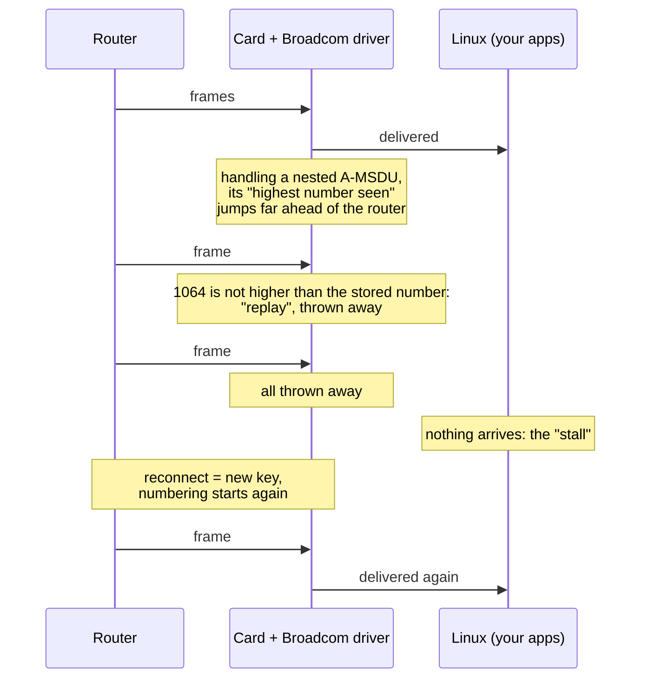

# The BCM4360 Wi-Fi stall, explained simply

This page explains, in plain language, what goes wrong, how the cause was tracked
down step by step, and what we know for certain versus what we can only infer.
The [README](../README.md) has the short technical version and the fix.

## The problem in one paragraph

During a big download or a video stream, the Wi-Fi suddenly stops working. The
computer still says it is connected, the signal looks fine, and it can still
send. But nothing comes back. It stays like that until you switch Wi-Fi off and
on again. Here it happened about once a minute at full speed.

## Four ideas you need first

**1. Every encrypted Wi-Fi frame carries a number.** With WPA2, each frame the
router sends is stamped with a number that only ever goes up: 1, 2, 3, and so on.
(The official name is "packet number", or PN.)

**2. The receiver remembers the highest number it has accepted.** If a frame
arrives with a number that is *not higher* than that, it is thrown away as a
"replay". This is a security feature: it stops an attacker from recording old
frames and sending them again. Think of a doorman who notes down the number on
every ticket and refuses any ticket number he has already seen or passed.

**3. Fast Wi-Fi sends frames in bundles.** Instead of sending frames one by one,
the router packs up to 64 of them into a single burst. This is called an
**A-MPDU**. Think of a lorry carrying many parcels. Each parcel still has its own
number. Parcels can arrive out of order, and the receiver puts them back in order.

**4. A single frame can also carry several packets.** Several network packets can
be packed into one frame, called an **A-MSDU**. Think of one parcel with several
letters inside. All the letters share the parcel's one number.

Routers can combine the two: a lorry (A-MPDU) full of parcels, some of which hold
several letters (A-MSDU). This is normal 802.11ac behaviour, and the receiver says
at the start whether it can handle it.

## What goes wrong

When the router sends that combined kind (letters inside parcels inside a lorry),
Broadcom's closed driver code ends up with a "highest number seen" that is
**higher than the numbers the router is actually using**. From that moment, every
new frame from the router looks old to it, so every frame is thrown away as a replay.

This explains everything you see:

- **Still "connected":** the radio link is fine. The card keeps receiving the
  router's beacons and frames. They are just rejected after decryption.
- **Sending still works:** only the receive check is broken.
- **Switching Wi-Fi off and on fixes it:** a new connection gets a new encryption
  key, both sides start numbering from zero again, and the bad stored number is gone.
  (Of 14 stalls the watchdog recovered, a reconnect fixed 12. Twice only reloading the
  driver helped, which also throws the stored number away.)
- **It happens under load:** most likely because that is when the router has
  enough data queued to build nested bundles.

## How we found it, step by step

We did not start out suspecting encryption. We tested the usual suspects first and
ruled each one out with a measurement. To do that we built a debug version of the
driver that counts what it does. We also wrote a watchdog that takes a snapshot of
everything the moment reception stops.

| Step | Question | How we tested it | Result |
|---|---|---|---|
| 1 | Bad signal or antennas? | Measured signal, link speed and download speed | −59 to −63 dBm, link at 877–1053 Mbit/s, downloads over 300 Mbit/s. **Not it.** |
| 2 | Is the card's interrupt (its "I have data" signal) getting lost? | Counted interrupts during a stall | Interrupts kept arriving every few milliseconds. **Not it.** |
| 3 | Is the driver leaving interrupts switched off, or has the card's receive engine frozen? | During a stall, re-enabled interrupts, prodded the card, and reset its receive engine | None of it helped. The card kept handing frames to the driver: 59 frames in 1.2 seconds, but **0** passed on to Linux. **Not it.** |
| 4 | So what happens to those frames? | Read the card's own statistics at the start and end of each stall | **Every** data frame from the router was counted as "could not decrypt", and the reason was "replay" (table below). |
| 5 | Did the router change keys? | Looked for key exchanges in the logs | None between connecting and the first stall. **Not it.** |
| 6 | What makes the number jump? | Switched features off one at a time and counted stalls | Pointed to the nested bundles (next section). |
| 7 | Did our own earlier changes cause it? | Repeated the test from scratch on Ubuntu's untouched driver | The untouched driver stalled 5 times in 10 minutes. **It's in the original.** |
| 8 | Does the stored number really jump? | Built a debug driver that shows the stored number, and watched it through 3 stalls | It jumped by 2 million to 1 billion at the exact moment each stall began (below). |

### The evidence from step 4

These are the card's own counters, read at the start and the end of the stall,
about one second apart. Across all 15 stalls we recorded, 215 of the 216 data frames from the router were rejected as replays. A sample:

| Stall | Data frames from the router | Could not decrypt | Rejected as replay | Beacons (radio still fine) |
|---|---|---|---|---|
| 23:18 | 35 | 34 | 34 | 11 |
| 23:20 | 10 | 10 | 10 | 11 |
| 02:02 | 36 | 36 | 36 | 12 |
| 02:03 | 16 | 16 | 16 | 12 |
| 02:12 | 15 | 15 | 15 | 12 |

The three numbers match: every frame the router sent to this PC was rejected,
and the reason was always "replay". Beacons kept arriving, so the radio was
fine. The problem was the stored number.

### Finding the trigger (step 6)

The obvious suspect was bundling, because that is where frames arrive out of order
and the number check is hardest to get right. To test that we needed to switch
bundling off. That turned out to be the hardest part of the whole investigation.

**The locked settings.** Broadcom's driver has settings for bundling, but it
refused every attempt to change them with "unsupported". We took apart (disassembled)
the closed part of the driver to find out why. It contains a list of all its
settings, and each entry has a flag that means "allowed on Linux". Only some
settings have that flag. Every setting that worked had it, and every one that was
refused did not. We wrote a small script that sets that flag on 11 entries in
your *own local copy* of the driver file: 11 bytes in total, nothing else touched.

With the settings unlocked we could finally test one thing at a time, under the
same download load:

| Setting | Stalls | Speed |
|---|---|---|
| Bundling (A-MPDU) on, the default | 4 in 4 min | 190 Mbit/s |
| Bundling off completely | **0** in 5 min | 60 Mbit/s |
| Nested A-MSDUs allowed, the default | 3 in 4 min | 232 Mbit/s |
| Nested A-MSDUs refused, everything else on | **0** in 5 min | **346 Mbit/s** |

Turning all bundling off stopped the stalls but made Wi-Fi far slower. Refusing
*only the nested kind* stopped them **without any loss of speed**. It was faster
here, because there were no stalls eating into the download.

**What that one setting actually does.** We checked in the closed code where the
setting is used. It is used in exactly one place: when the router proposes a
bundled transfer, the receiver replies "yes, and I accept A-MSDUs inside it" or
"yes, but no A-MSDUs inside". So turning it off changes only one thing: whether
the router nests A-MSDUs inside the bundles. Because that change alone makes the
stalls go away, the bug must be in how the closed code handles those nested frames.

### Watching the stored number (step 8)

Broadcom's driver has no command that reports the stored number, so at first we could
only infer it. In the closed code we then found where it keeps it: for each key, four
"highest number accepted" slots, which it compares every encrypted frame against.
We added a small read-only file, `/proc/wl_keys`, to a debug build of the driver.
It shows those slots (never the key itself). Then we read it five times a second while
downloading.

With the fix on, for 60 seconds: the stored number climbed steadily, by about 1,000 to
6,000 every fifth of a second, in step with the downloads. No replays.

With the fix switched off, all three stalls looked the same:

| Stall | Stored number just before | A fifth of a second later | Jump | Replays in that fifth of a second |
|---|---|---|---|---|
| 1 | 22,551 | 8,411,465 | +8.4 million | 407 |
| 2 | 81,894 | 2,114,237 | +2.0 million | 290 |
| 3 | 79,125 | 1,084,307,715 | +1.08 billion | 160 |

- The jump and the first replays happen **in the same fifth of a second**, every time.
- After the jump, the stored number **stays frozen** at the wrong value, because every
  new frame is rejected. Nothing gets through until the reconnect replaces the key.
- At full download speed the router's numbers went up by about 1,500 a second (about
  80,000 in a minute). At that rate, catching up with even the smallest jump
  (2 million) would take over 20 minutes, and the largest about 9 days. That is why
  the stall doesn't end by itself.
- The number is stored in two parts, a low part (16 bits) and a high part (32 bits).
  In all three jumps the **low part carried on correctly**. Only the **high part
  became a wrong value** (0x80, 0x20 and 0x40a1 instead of 0 or 1). So the driver
  isn't miscounting. Part of the number it stores is wrong.

The debug change is in [`tools/keyview-debug.patch`](../tools/keyview-debug.patch). It is
for checking this result only. It reads memory locations taken from this one version of
Broadcom's file, so don't use it with any other version.

### Checking the result

- **Long test:** 20 minutes of full-speed downloads with the fix: 0 stalls,
  44.7 GB at an average of 298 Mbit/s. Without the fix, around 20 stalls would be
  expected.
- **Clean test from scratch:** starting from Ubuntu's untouched driver:

  | Driver | Stalls | Speed |
  |---|---|---|
  | Untouched Ubuntu driver, 10 min | 5 | not measured reliably¹ |
  | Untouched driver + only this fix, 10 min | **0** | 347 Mbit/s |
  | Same build with the fix switched off again, 5 min | 8 | 194 Mbit/s |

  The last two rows are the same driver file. The only difference is one setting
  given when the driver loads, and it flips the result from 0 to 8 stalls.

¹ The first version of the test tool had a counting bug: this driver's byte
counter rolls over every 4 GB. Its stall count was fine. The tool is fixed now.

## What we know, what we infer, and what we don't know

**Measured directly (certain):**
- Every stall is the card throwing away every frame from the router as a replay.
- The stalls happen with Ubuntu's untouched driver.
- Refusing nested A-MSDUs stops them. Allowing them again brings them back, in the
  same driver build.
- The setting changes only the answer the driver gives when the router sets up
  bundling.
- The driver's stored "highest number" jumps far ahead of the router's at the moment
  a stall begins, and stays there (step 8). The jump sizes were 2 million, 8 million
  and 1 billion.
- In those jumps, only the high part of the stored number went wrong. The low part
  carried on normally.

**Inferred (very likely, not seen directly):**
- The nested A-MSDUs are what make the high part go wrong. The jumps only happen when
  nested A-MSDUs are allowed. When the driver accepts a frame, it stores that frame's
  number plus one. It does this before it splits an A-MSDU into its letters. Our best
  guess: for some of these frames, it reads the high part of the number from the wrong
  place. We have not seen which frame does it.
- Short stalls. One earlier stall cleared by itself after about 3 seconds. Presumably
  that jump was small enough for the router to overtake. All three we measured were
  far too large for that.

**Not known:**
- The exact faulty instruction inside Broadcom's code. It is closed source. We can see
  the wrong number being stored, but not which code path stores it.
- How many routers trigger it. Only routers that send A-MSDUs inside A-MPDUs can;
  ours does. This was tested with one card and one router.

**A known pitfall:** Linux's own Wi-Fi code ran into the same trap. The letters
from one A-MSDU all share one number, and the replay check rejected all but the
first. Linux had to add a special rule for this case ([the Linux change](https://kunit.googlesource.com/linux/+/f631a77ba920f7153a1094d09cd8f2ebbffd0328)).
Broadcom's code needs the same care, and evidently gets it wrong in some cases.

## Why the fix is safe

- **It is standard Wi-Fi.** Declining nested A-MSDUs is an option the 802.11
  standard gives every receiver. The router simply sends plain bundles instead.
- **Security is unchanged.** The replay check stays fully on. We only avoid the
  frame format that confuses it.
- **Speed is the same or better.** The bundling that matters for speed (A-MPDU)
  stays on.
- **It only touches your local copy.** The 11-byte unlock is applied to the
  driver file on your own machine at build time. Broadcom's file is not
  redistributed, and `apply.sh --undo` puts the stock driver back.

## Why others have struggled with this for years

People have reported the same symptom with this card since at least 2013: still
connected, traffic stops, reconnecting helps ([Manjaro 2020](https://forum.manjaro.org/t/bcm4360-connection-stops-working-but-is-not-dropped-randomly/43592),
[Launchpad #1256158](https://bugs.launchpad.net/bugs/1256158)). It is hard to
pin down because:

- Nothing appears in the system logs. The connection never drops, so no tool
  reports a disconnect.
- It depends on the router. Changing channel, band or router can make it vanish,
  which sends people in the wrong direction.
- The counters that reveal it can't be read on newer kernels without a patch (our
  patch 0002), and the setting that fixes it is locked by default.
